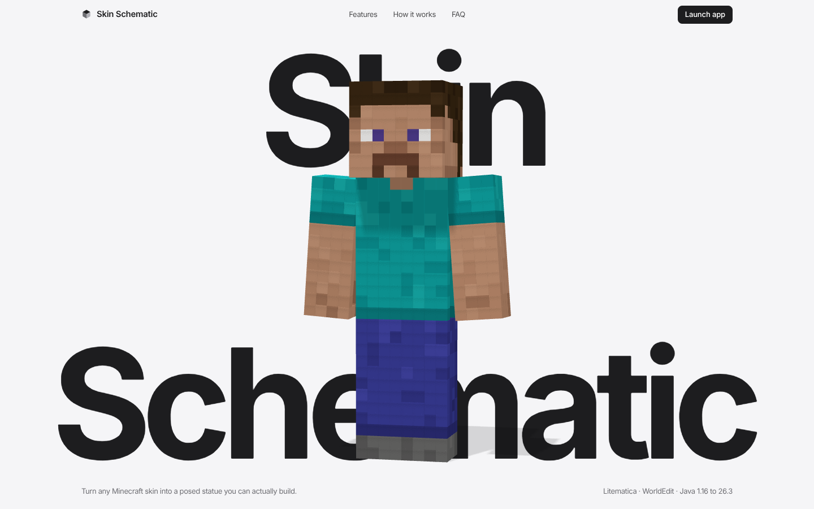
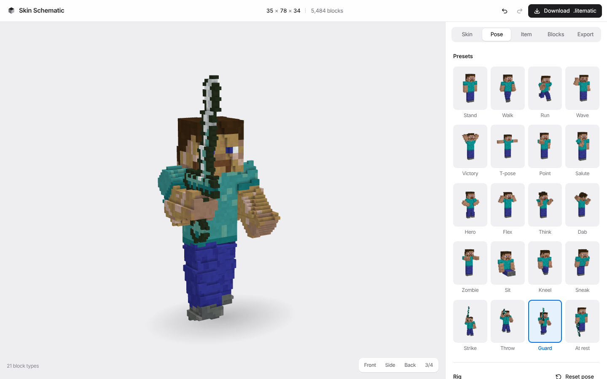

# Skin Schematic

Turn any Minecraft skin into a posed statue you can build. Pick a pose, rig the head, shoulders and hips, put a sword, axe, pickaxe, mace or trident in its hand, choose a block style and a size, and download a **Litematica** (`.litematic`) or **WorldEdit** (`.schem`) schematic.

Everything runs in the browser. Skins never leave the device; the only network request is the optional username lookup.




## Features

- **Any skin.** Drop or paste a PNG, or type a Java username. 64×64 and legacy 64×32 skins, classic and slim arms (detected automatically), and the outer layer as a real 3D shell (like the 3D Skin Layers mod) or flattened.
- **20 pose presets** with live thumbnails rendered from your skin: stand, walk, run, wave, victory, T‑pose, point, salute, hero, flex, think, dab, zombie, sit, kneel, sneak, plus four battle poses for held items.
- **Full rig.** Head (look, turn, tilt), body (lean, twist), and each arm and leg on three axes, with elbow and knee bends. Click any part of the statue to select it. Undo and redo with ⌘Z / ⇧⌘Z.
- **Held items.** Sword, axe, pickaxe (wood, stone, iron, gold, diamond, netherite), mace and trident, in either hand, at any grip angle. Original pixel art, drawn for this project.
- **Nine block styles.** Full color, Concrete, Wool, Terracotta, Survival (common blocks only), Natural (no dyes), and three monochrome monuments: Stone, Gilded and Onyx.
- **Size 1× to 8×** (32 to 256 blocks tall), hollow or solid, optional pedestal, and an optional cap on the number of block types.
- **Version aware.** Targets Java 1.16 through 26.3. Only blocks that exist in the chosen version are used, and the file carries the matching DataVersion and Litematica format version.
- **Material list** with stack and shulker-box counts, copyable or as CSV.

## How the conversion works

1. **Skin.** The image is normalized the way the game does it (legacy upgrade, forced-opaque base layer, the old "solid hat" rule).
2. **Rig.** The pose becomes rigid segments (head, body, upper and lower arms and legs) with 4×4 transforms. Bent limbs are split at the elbow or knee, and each half overlaps a little so the bend has no gap.
3. **Voxelize.** For every voxel in each segment's bounding box, the voxel center is mapped back into the segment's rest space. Inside the box it takes the texel of the nearest face; just outside it, the outer layer forms a one-voxel shell. Items are one-pixel-thick sprites in the hand's frame, exactly like the game renders held items.
4. **Match blocks.** Colors are compared in OKLab with extra weight on hue (so tan skin doesn't turn pink), plus a small penalty for speckled textures. Block colors are the mean of each block's real texture, computed by [`scripts/compute-block-colors.py`](scripts/compute-block-colors.py); only the averages are stored, never the textures.
5. **Export.** A minimal NBT writer produces the files:
   - `.litematic`: `Version` 5/6/7 by target, `MinecraftDataVersion`, metadata with a 140×140 preview image, one region with `BlockStatePalette` and `BlockStates` packed like `LitematicaBitArray` (tight little-endian bit stream across longs, `max(2, ceil(log2(n)))` bits).
   - `.schem`: Sponge Schematic v2 with varint `BlockData`.

The statue faces south (+Z). Rotate it in Litematica's placement settings if you need another direction.

## Using a schematic

1. Put the `.litematic` file in `.minecraft/schematics`.
2. In game press <kbd>M</kbd> → *Load Schematics* → pick the file → *Load*.
3. Move the placement where you want it and build, or paste it in creative.

For WorldEdit: put the `.schem` file in `config/worldedit/schematics` (`plugins/WorldEdit/schematics` on a server), then `//schem load <name>` and `//paste`.

## Development

```bash
npm install
npm run dev        # http://localhost:5173 (also serves /api/skin locally)
npm test           # exporter tests, including a port of Litematica's bit-array reader
npm run build      # type-check and production build into dist/
```

Stack: React, TypeScript, Vite, Three.js, fflate. Voxelization runs in a Web Worker.

```
src/lib/skin      skin layout, loading, default skin (painted in code)
src/lib/rig       pose model, presets, matrices
src/lib/voxel     voxelizer, item sprites, mesher with ambient occlusion
src/lib/blocks    block data, styles, OKLab matcher
src/lib/export    NBT, .litematic and .schem writers
src/pages         landing page and studio
api/skin.ts       Vercel function: username -> skin (Mojang has no CORS)
```

## Deploying to Vercel

Import the repository in Vercel and deploy. The settings are already in `vercel.json` (Vite preset, `dist` output, SPA rewrites). `api/skin.ts` deploys as a Node.js function with no configuration or environment variables. Without it (any static host), username lookups fall back to a public skin mirror, and file uploads always work.

[](https://vercel.com/new/clone?repository-url=https://github.com/AD-2-17/minecraft-skin-schematics-)

## What's verified, and what isn't

- The exporters are covered by unit tests, and generated files were parsed with an independent NBT library (`nbtlib`) and decoded with Litematica's own bit-array algorithm.
- Exported files have **not** been loaded inside a running Minecraft client as part of this repository's tests. If a file misbehaves in your version of Litematica, please open an issue with the version numbers.

## Credits

Format details come from the [Litematica](https://github.com/sakura-ryoko/litematica) source and the [Sponge Schematic](https://github.com/SpongePowered/Schematic-Specification) spec. Block lists and version data come from [misode/mcmeta](https://github.com/misode/mcmeta).

Not an official Minecraft product. Not approved by or associated with Mojang or Microsoft.
